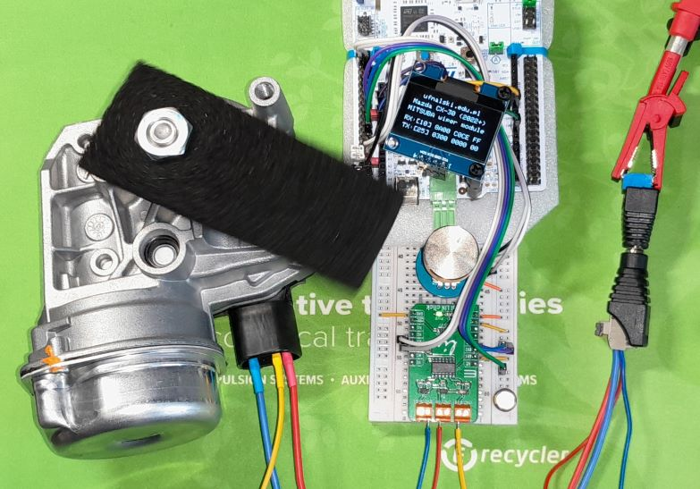

# Mazda CX-30 (2023) MITSUBA WM23B front wiper module with brushless motor and LIN bus interface [STM32C562RE]

Inspired by [eCarEdu](https://www.youtube.com/watch?v=-gBkNWhi_VA). The part number is [51550011 WM230-011](https://allegro.pl/listing?string=wm23) by [MITSUBA](https://www.mitsuba.co.jp/en/).

> [!NOTE]
> It is the world's first standard front wiper module that uses a 4-pole brushed wiper motor. Regarded as the world's top class compact wiper module due to the optimization of the electromagnetic circuit of the motor and the highly efficient deceleration mechanism. Source: [MITSUBA front wiper module flyer](https://www.mitsuba.co.jp/en/vpep/products/product_details/front_wiper_module_details.html)

# Missing files?
Don't worry. Just open the .ioc2 file in STM32CubeMX2 and hit the yellow button to generate the IDE project. Then open the project in STM32CubeIDE for Visual Studio Code and build it.

# What's inside?

# Call to action
Create your own [home laboratory/workshop/garage](http://ufnalski.edu.pl/control_engineering_for_hobbyists/2027_fun_with_electric_motors_and_control_systems/Fun_with_Electric_Motors_and_Control_Systems_2027.pdf)! Get inspired by [ControllersTech](https://www.youtube.com/@ControllersTech), [DroneBot Workshop](https://www.youtube.com/@Dronebotworkshop), [Andreas Spiess](https://www.youtube.com/@AndreasSpiess), [GreatScott!](https://www.youtube.com/@greatscottlab), [bitluni's lab](https://www.youtube.com/@bitluni), [ElectroBOOM](https://www.youtube.com/@ElectroBOOM), [Phil's Lab](https://www.youtube.com/@PhilsLab), [atomic14](https://www.youtube.com/@atomic14), [That Project](https://www.youtube.com/@ThatProject), [Paul McWhorter](https://www.youtube.com/@paulmcwhorter), [Max Imagination](https://www.youtube.com/@MaxImagination), [Nikodem Bartnik](https://www.youtube.com/@nikodembartnik), [Stuff Made Here](https://www.youtube.com/@StuffMadeHere), [Mario's Ideas](https://www.youtube.com/@marios_ideas), [Aaed Musa](https://www.aaedmusa.com/), [Haase Industries](https://www.youtube.com/@h1tec), [Marcin Plaza](https://www.youtube.com/MarcinPlaza), [Predictable Designs with John Teel](https://www.youtube.com/@PredictableDesigns), [Mr Carlson's Lab](https://www.youtube.com/@MrCarlsonsLab), [Piotr Gorecki](https://www.youtube.com/@piotrgorecki_ZE), and many other professionals and professional hobbyists sharing their awesome projects and tutorials! Shout-out/kudos to all of them! Promote [README-driven learning](https://pe.org.pl/wp-content/uploads/2026/06/10_15199_48_2026_06_9.pdf).

> [!WARNING]
> Automotive servo drives - do try them at home :grey_exclamation:

230+ challenges to start from: [Control Engineering for Hobbyists at the Warsaw University of Technology](http://ufnalski.edu.pl/control_engineering_for_hobbyists/Control_Engineering_for_Hobbyists_list_of_challenges.pdf).

Stay tuned!

0xBU
